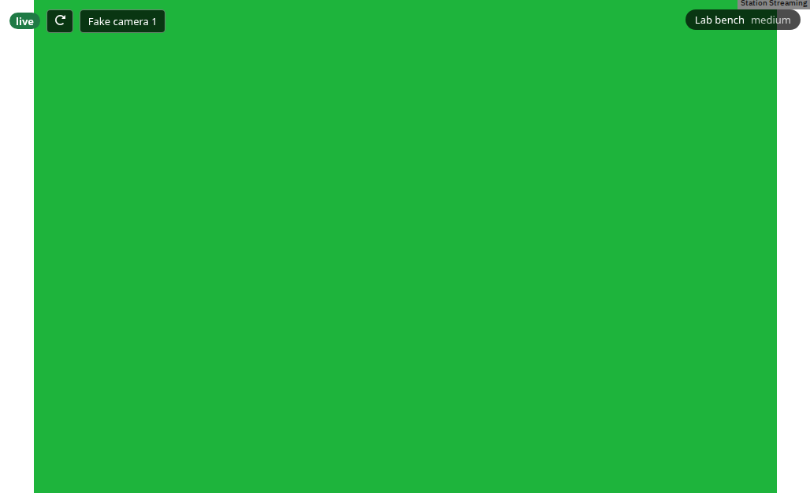
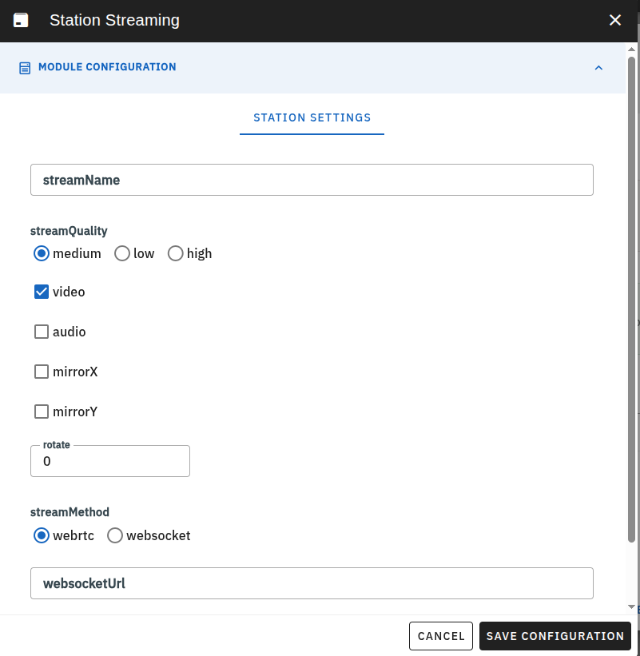

# Edrys Station-Stream Module

This module will allow a station to send a video and or audio stream to all connected users via a direct WebRTC connection or via a WebSocket connection.

Import the module via:

`https://edrys-labs.github.io/module-streaming/index.html`

<!--

-->

## Roles

The module runs in station rooms only (`show-in: station`).

- **Station:** the station window captures its camera and/or microphone and sends the stream. It shows a muted
  preview of what it sends.
- **Teachers and students:** everyone who enters the station's room watches the stream. A student who joins
  later gets the running stream.

Controls in the top-left corner:

- **Status badge:** `connecting` (or `starting` on the station), `live`, or `no stream` when something went
  wrong. The message in the middle of the video says what to do.
- **Reconnect button:**
  - On the station, it captures the camera again and sends the new capture to every viewer.
  - On a viewer, it rebuilds only that viewer's own connection.
  - A viewer that gets no picture within 20 s reconnects once by itself, and then asks the user to press the
    button.
- **Camera picker:** the station only, shown when it has two or more cameras. The choice is remembered per
  stream for the browser tab.

When the station loses its camera (unplugged, or taken by another program), it shows "Camera disconnected,
retrying…" and tries again every 3 seconds. The viewers get the picture back without doing anything.

To stream several cameras from one station, add the module several times, with a different `streamName` each.

## Settings

You can modify the module station settings via the configuration form:



Every setting is optional. Without a value, the module uses these defaults:

| Setting | Default | Values |
|---------|---------|--------|
| `streamName` | `Camera 1` | any text, unique per station |
| `streamQuality` | `medium` | `low` (640×480, 15 fps), `medium` (1280×720, 24 fps), `high` (1920×1080, 30 fps) |
| `video` | `true` | `true` / `false`: stream the camera |
| `audio` | `false` | `true` / `false`: stream the microphone |
| `mirrorX`, `mirrorY` | `false` | `true` / `false` |
| `rotate` | `0` | degrees: `0`, `90`, `180`, `270` |
| `streamMethod` | `webrtc` | `webrtc` or `websocket` |
| `websocketUrl` | (none) | relay URL, needed for `websocket` |
| `peerServerConfig` | PeerJS cloud | PeerJS server settings (YAML/JSON only) |

Or you can set the parameters manually in the station configuration via yaml:

``` yaml
streamName: "Stream 1" # Name of the stream
streamQuality: "medium"  # low, medium, high
video: true
audio: false
mirrorX: false
mirrorY: true
rotate: 90
streamMethod: "webrtc" # or "websocket"
websocketUrl: "wss://your.websocket.server/stream" # only needed if streamMethod is "websocket"
peerServerConfig: # Optional PeerJS server configuration
  host: "your.peer.server" # without https://
  port: 443
  path: "/"
  secure: true
```

or via json:

``` json
{
    "streamName": "Stream 1",
    "streamQuality": "medium",
    "video": true,
    "audio": false,
    "mirrorX": false,
    "mirrorY": true,
    "rotate": 90,
    "streamMethod": "webrtc",
    "websocketUrl": "wss://your.websocket.server/stream",
    "peerServerConfig": {
        "host": "your.peer.server",
        "port": 443,
        "path": "/",
        "secure": true
    }
}
```

The flip parameters (mirrorX, mirrorY) will flip the video stream on the X or Y axis respectively. The rotate parameter will rotate the video stream by the specified degrees (0, 90, 180, 270).

## Stream methods

- **`webrtc` (default):** the station sends the stream peer to peer to every viewer. Signalling goes through the
  PeerJS cloud, or through your own PeerJS server set in `peerServerConfig`.
- **`websocket`:** the station sends the stream to a relay, and the relay forwards it to the viewers. Use this when
  peer-to-peer connections are blocked, for example by a school firewall. The relay is the `/stream` endpoint of
  the [edrys-labs websocket-server](https://github.com/edrys-labs/websocket-server). Set `websocketUrl` to it,
  e.g. `wss://your.websocket.server/stream`.

## Browsers

- **Station:** needs a browser with camera access, which works only over HTTPS. Chrome is recommended.
- **Viewers:** any browser with WebRTC support can watch a `webrtc` stream.
- **The `websocket` method** needs `MediaRecorder` and `MediaSource`, and its viewers need
  `HTMLMediaElement.captureStream()`. Chrome, Edge and Firefox have them. Safari is not supported for this method.

## License

[MIT](LICENSE) © edrys-labs